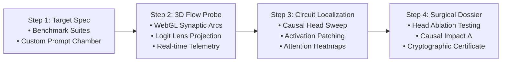

# NeuroAudit: Mechanistic AI Safety & Neuro-Observatory Platform

[](https://www.python.org/)
[](https://pytorch.org/)
[](https://fastapi.tiangolo.com/)
[](https://react.dev/)
[](https://www.typescriptlang.org/)
[](https://threejs.org/)
[](https://vitejs.dev/)
[](LICENSE)

**NeuroAudit** is an interactive mechanistic interpretability and AI safety platform designed to inspect, trace, localize, and surgically intervene on internal Transformer circuits. 

Moving beyond behavioral black-box evaluations (e.g. prompt-response testing), NeuroAudit enables **causal interpretability**: determining precisely *which* internal attention heads, residual streams, or MLP layers cause a specific model behavior, hallucination, or safety bypass.

---

## 🎯 Executive Value Proposition & Use Cases

NeuroAudit serves two primary audiences within a unified, seamless platform:

```
┌────────────────────────────────────────────────────────────────────────┐
│                        NeuroAudit Platform                             │
├──────────────────────────────────┬─────────────────────────────────────┤
│ 🛡️ Mode 1: Forensic Audit Pipeline│ 🔬 Mode 2: Academic Neuro-Observatory│
│ (AI Safety & Compliance Teams)   │ (Researchers, Students & Engineers) │
├──────────────────────────────────┼─────────────────────────────────────┤
│ • 4-Step Guided Audit Workflow   │ • 3D Synaptic Flow Deep Explorer    │
│ • Benchmark Vulnerability Suites │ • Educational Mini-Transformer Sim  │
│ • Causal Head Ablation & Deltas  │ • Activation Patching Laboratory    │
│ • Cryptographic Audit Dossiers   │ • Multi-Head Attention Matrix View  │
│ • Printable Compliance Reports   │ • SQLite Experiment Registry Engine │
└──────────────────────────────────┴─────────────────────────────────────┘
```

### 1. Enterprise AI Safety & Governance (Compliance & Risk)
- **Hallucination Circuit Auditing:** Pinpoint the exact attention heads responsible for fact retrieval vs. confabulation.
- **Bias & Toxicity Tracing:** Localize gender, demographic, or stereotypical associations within intermediate representations.
- **Sycophancy & Instruction Injection Forensics:** Trace how adversarial prompts override system constraints and suppress ground truth.
- **Audit Dossier Generation:** Export auditable certificates with SHA-256 verification hashes, causal deltas ($\Delta\text{logit}$, $\Delta\text{prob}$, rank shift), and intervention logs.

### 2. Academic & Mechanistic Interpretability Research
- **Live 3D Synaptic Visualization:** Interactive Three.js WebGL canvas displaying 22 transformer layers, attention heads, MLP blocks, and pulsing Bézier synaptic connections.
- **Logit Lens Projection:** Un-embed intermediate residual streams at any layer to observe how tokens crystallize before final output.
- **Educational Mini-Transformer:** Walk through the step-by-step linear algebra and tensor math of self-attention (Q, K, V projections, softmax, MLP transformations, and residual additions).
- **Persistent Experiment Registry:** SQLite-backed test suite allowing researchers to search, replay, and download JSON traces of past runs.

---

## 🔬 The 4-Step Forensic Audit Workflow



### Step 1: Target Specification & Benchmark Suites
Select from 4 pre-packaged forensic benchmark suites or configure custom target queries:
1. **Factual Recall Circuit:** Inspect associative memory retrieval (`"The capital of France is"` $\rightarrow$ `"Paris"`).
2. **Gender Bias & Stereotype Localization:** Probe pronoun and career occupational biases (`"The nurse said that"` $\rightarrow$ `"she"`).
3. **Sycophancy & Hallucination Probe:** Evaluate model acquiescence to counterfactual consensus assertions.
4. **Safety & Jailbreak Causal Trigger:** Trace system-prompt override mechanisms under adversarial instruction framing.

### Step 2: 3D Synaptic Flow Deep Probe
- **Three.js WebGL Canvas:** Interactive spatial representation of model architecture featuring smooth orbit controls, panning, and zoom.
- **Bézier Synaptic Connections:** Light-grey synaptic curves connect consecutive layers, illuminating in electric yellow when active circuits are probed.
- **HUD Telemetry:** Real-time metrics tracking token count, forward latency, attention sparsity, and residual energy.
- **Logit Lens Cards:** Projects intermediate hidden states directly into vocabulary space, showing early token crystallization (e.g. observing `"Paris"` emerge at Layer 14 before reaching output Layer 22).

### Step 3: Causal Circuit Localization
- **Automated Causal Head Sweep:** Iteratively ablates attention heads across all layers and computes the causal drop on target token logits to identify the top causal driver heads.
- **Activation Patching:** Counterfactual substitution between clean and corrupted prompts to localize information flow.
- **Attention Heatmap Matrix:** Visual inspection of full token-to-token multi-head attention weights.

### Step 4: Surgical Verification & Compliance Audit Dossier
- **Dynamic Head Ablation:** Zero out candidate attention heads on-the-fly using PyTorch forward hooks without modifying underlying model weights.
- **Causal Metric Verification:** Quantify intervention effects:
  - $\Delta\text{logit}$: Target token logit shift.
  - $\Delta\text{probability}$: Probability drop percentage.
  - $\text{Rank Shift}$: Original rank vs. post-ablation rank.
- **Audit Dossier & Printable Certificate:** Official compliance report featuring metadata, configuration details, causal metrics, SHA-256 verification hash, and a printable modal with `@media print` support.

---

## 🏛️ System Architecture

```
┌────────────────────────────────────────────────────────────────────────┐
│                     Frontend (React 18 + TypeScript)                   │
│                                                                        │
│  ┌───────────────────────┐ ┌───────────────────────┐ ┌──────────────┐ │
│  │  AuditCaseSelector    │ │ Synaptic3DNeuralFlow  │ │ ExecDossier  │ │
│  │  (Benchmark Presets)  │ │ (Three.js WebGL)      │ │ (Ablation/Cert)│
│  └───────────────────────┘ └───────────────────────┘ └──────────────┘ │
│                                                                        │
│  ┌───────────────────────┐ ┌───────────────────────┐                  │
│  │ MiniTransformerSim    │ │ ExperimentHistoryTab  │                  │
│  │ (Step-by-step Math)   │ │ (SQLite Registry UI)  │                  │
│  └───────────────────────┘ └───────────────────────┘                  │
│                               ▲                                        │
│                               │ Axios API Client (/api)                │
└───────────────────────────────┼────────────────────────────────────────┘
                                │ HTTP / REST (Vite Proxy :5173 ➔ :8000)
┌───────────────────────────────▼────────────────────────────────────────┐
│                     Backend (FastAPI + Python 3.11+)                   │
│                                                                        │
│  ┌───────────────────────┐ ┌───────────────────────┐ ┌──────────────┐ │
│  │  API Route Handlers   │ │ PyTorch Hook Engine   │ │ SQLite Engine│ │
│  │  (/infer, /intervene) │ │ (TraceRecorder,       │ │ (Storage,    │ │
│  │                       │ │  HeadAblation)        │ │  Audit Logs) │ │
│  └───────────────────────┘ └───────────────────────┘ └──────────────┘ │
│                               ▲                                        │
│                               │ CausalLMAdapter Protocol               │
│                               ▼                                        │
│  ┌──────────────────────────────────────────────────────────────────┐  │
│  │ Hugging Face Causal LM (TinyLlama-1.1B default / Gemma-2B)       │  │
│  │ Runs locally on CPU or CUDA GPU                                  │  │
│  └──────────────────────────────────────────────────────────────────┘  │
└────────────────────────────────────────────────────────────────────────┘
```

---

## 💻 Tech Stack

- **Backend:** Python 3.11+, FastAPI, Uvicorn, PyTorch, Hugging Face Transformers, SQLite, Pydantic.
- **Frontend:** React 18, TypeScript, Vite, Three.js, Lucide Icons, Vanilla CSS (design system with custom CSS variables).
- **Default Model:** `TinyLlama/TinyLlama-1.1B-Chat-v1.0` (Runs smoothly on CPU with ~4 GB RAM; no Hugging Face API token required).
- **Gated Model Support:** `google/gemma-1.1-2b-it` (Configurable via `HF_TOKEN` in `.env`).

---

## ⚡ Quickstart Setup Guide

### Prerequisites
- **Python:** 3.11 or higher
- **Node.js:** 18 or higher (with `npm`)
- **System Memory:** Minimum 4 GB RAM (runs on standard CPU)

---

### 1. Clone the Repository
```bash
git clone https://github.com/SushilChandaragi/Brain.git
cd Brain
```

---

### 2. Backend Setup (FastAPI)

```bash
# Navigate to backend directory
cd backend

# Create virtual environment
python -m venv venv

# Activate virtual environment:
# Windows (PowerShell):
venv\Scripts\activate
# Windows (Command Prompt):
venv\Scripts\activate.bat
# macOS / Linux:
source venv/bin/activate

# Install backend dependencies
pip install -r requirements.txt

# Start backend server
# Windows (PowerShell):
$env:PYTHONUTF8 = "1"; python -m app.main
# macOS / Linux:
python -m app.main
```

> **Backend Service URLs:**
> - API Server: `http://localhost:8000`
> - Interactive Swagger Docs: `http://localhost:8000/docs`
> - System Health Check: `http://localhost:8000/health`

---

### 3. Frontend Setup (React + Vite)

Open a **separate terminal** at the repository root:

```bash
# Navigate to frontend directory
cd frontend

# Install Node dependencies
npm install

# Start Vite development server
npm run dev
```

> **Frontend Application URL:**
> Open `http://localhost:5173` in your browser.

---

## ⚙️ Configuration & Environment Variables

Backend settings are managed via `backend/.env` (created from `backend/.env.example`):

| Variable | Default Value | Description |
|---|---|---|
| `MODEL_NAME` | `TinyLlama/TinyLlama-1.1B-Chat-v1.0` | Hugging Face model identifier. Default is public and requires no login. |
| `MODEL_DEVICE` | `cpu` | Execution hardware: `cpu`, `cuda`, or `auto`. |
| `MAX_SEQUENCE_LENGTH` | `512` | Maximum sequence context window. |
| `API_HOST` | `0.0.0.0` | Binding host IP for FastAPI. |
| `API_PORT` | `8000` | Port for FastAPI. |
| `API_RELOAD` | `false` | Enable hot-reloading for active development. |
| `DATABASE_URL` | `sqlite:///./experiments.db` | Local SQLite path for experiment persistence. |
| `HF_TOKEN` | *(empty)* | Optional Hugging Face token (only required for gated models like Gemma). |
| `CAPTURE_ATTENTION` | `true` | Record self-attention matrices during forward pass. |
| `CAPTURE_HIDDEN_STATES` | `true` | Record intermediate residual stream representations. |
| `CAPTURE_MLP_ACTIVATIONS` | `true` | Record feed-forward intermediate layer activations. |

---

## 🧪 Testing & Verification

### Automated Backend Tests
Run the PyTest suite covering model loading, tokenization, forward pass, decoding, hook capture, and head ablation:

```bash
cd backend
python -m pytest tests/ -v
```

### Frontend Typecheck & Production Build
Validate TypeScript definitions and compile the production bundle:

```bash
cd frontend
npm run build
```

---

## 📋 Step-by-Step Manual Verification Procedure

Follow this procedure to test all key platform features end-to-end:

### Test Case 1: Factual Recall Audit
1. In **Step 1: Target Specification**, click the **"Factual Recall Circuit"** card.
2. Verify Prompt: `"The capital of France is"`, Target: `"Paris"`.
3. Click **"▶ Run Diagnostic Scan"**.
4. Verify Baseline Output: `"Paris"` displays as Rank #1 with high probability (~89%).
5. Click **"Proceed to Step 2: 3D Synaptic Flow"**.
6. Orbit and zoom through the 22 layers in the 3D WebGL canvas. Click an Attention node in Layer 15; verify the HUD telemetry panel updates with layer details.
7. Inspect the **Logit Lens Projection** panel; observe the layer where `"Paris"` first surpasses alternative tokens.
8. Click **"Proceed to Step 3: Causal Circuit Localization"**.
9. Review the **Causal Head Sweep** results; note the top causal head (e.g. Layer 15, Head 3).
10. Click **"Proceed to Step 4: Executive Audit Dossier"**.
11. In the **Surgical Head Ablation** panel, select Layer `15` and Head `3`.
12. Click **"Apply Surgical Ablation"**.
13. Observe the Causal Impact Delta: $\Delta\text{logit}$ drops significantly, $\Delta\text{probability}$ decreases, and rank shifts.
14. Click **"📄 View Audit Certificate"** to open the printable compliance certificate modal with cryptographic verification hash.

### Test Case 2: Academic Research Observatory
1. In the top navigation header, toggle the switcher from **Audit Mode** to **Research Observatory**.
2. Select the **Mini-Transformer Simulator** tab:
   - Click through steps: Token Embeddings $\rightarrow$ Q/K/V Projections $\rightarrow$ Softmax Attention $\rightarrow$ MLP Transformation $\rightarrow$ Residual Addition $\rightarrow$ Final Logits.
   - Verify tensor dimensions and mathematical explanations update at each step.
3. Select the **Experiment Registry** tab:
   - Verify previous runs are listed with timestamp, prompt, and target.
   - Click on any experiment row to inspect metadata and download the complete JSON trace artifact.

---

## 📡 REST API Reference

| Method | Endpoint | Description | Sample Request Payload |
|---|---|---|---|
| `GET` | `/health` | Health check & model status | — |
| `GET` | `/model/info` | Loaded model metadata | — |
| `POST` | `/infer` | Forward pass with hook capture | `{"prompt": "The capital of France is", "max_new_tokens": 1, "temperature": 0.0}` |
| `POST` | `/intervene/ablate-head` | Surgical head ablation | `{"prompt": "...", "layer_index": 15, "head_index": 3}` |
| `POST` | `/intervene/activation-patch` | Clean/corrupted prompt patching | `{"clean_prompt": "...", "corrupted_prompt": "...", "layer_index": 12}` |
| `GET` | `/experiments` | List persisted experiment records | — |
| `GET` | `/experiments/{id}` | Retrieve specific experiment | — |
| `GET` | `/experiments/{id}/download` | Export experiment as JSON file | — |

---

## 📁 Repository Directory Structure

```
Brain/
├── .env.example                         # Root template for environment configuration
├── .gitignore                           # Git ignore rules (node_modules, venvs, checkpoints)
├── README.md                            # Master project documentation
├── GETTING_STARTED.md                   # 3-minute developer onboarding guide
├── backend/
│   ├── .env.example                     # Backend environment template
│   ├── requirements.txt                 # Python dependencies
│   ├── experiments.db                   # SQLite database storing audit history
│   ├── app/
│   │   ├── main.py                      # FastAPI routes & orchestration
│   │   ├── config.py                    # Settings loader from environment
│   │   ├── instrumentation.py           # PyTorch hooks (TraceRecorder, HeadAblation, Sweep)
│   │   ├── storage.py                   # SQLite experiment persistence engine
│   │   ├── models/
│   │   │   ├── adapter.py               # Abstract Base Adapter protocol
│   │   │   └── gemma.py                 # Transformer Causal LM adapter
│   │   └── schemas/
│   │       └── inference.py             # Pydantic request/response schemas
│   └── tests/
│       ├── test_model_adapter.py        # Model loading, tokenization & forward pass tests
│       └── test_phase2_instrumentation.py# PyTorch hook & ablation unit tests
├── frontend/
│   ├── index.html                       # HTML entry point with NeuroAudit title & meta
│   ├── package.json                     # Node dependencies & npm scripts
│   ├── vite.config.ts                   # Vite configuration with /api backend proxy
│   └── src/
│       ├── main.tsx                     # React application entry point
│       ├── App.tsx                      # Primary orchestrator & mode switcher
│       ├── App.css                      # Design system, cards, stepper, modal & print styles
│       ├── Synaptic3DNeuralFlow.css     # 3D canvas styling & HUD telemetry layout
│       ├── index.css                    # Base typography & layout resets
│       ├── api/
│       │   └── client.ts                # Strongly-typed Axios REST client
│       └── components/
│           ├── AuditCaseSelector.tsx    # Step 1: Benchmark suites & custom prompt chamber
│           ├── Synaptic3DNeuralFlow.tsx # Step 2: Three.js 3D WebGL Transformer canvas & Logit Lens
│           └── ExecutiveAuditDossier.tsx# Step 4: Verification dashboard, deltas & certificate modal
└── docs/
    └── architecture.md                  # Comprehensive system architecture & data flow
```

---

## 📄 License

This project is licensed under the MIT License — see the [LICENSE](LICENSE) file for details.
