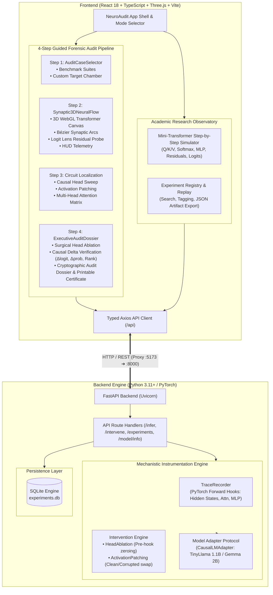

# NeuroAudit Architecture Overview

**NeuroAudit** is an interactive mechanistic interpretability and AI safety platform designed for deep transformer circuit auditing and causal verification.

---

## 1. High-Level System Architecture



---

## 2. Core Functional Modules

### A. Frontend Architecture (`frontend/src/`)

| Component | Path | Responsibility |
|---|---|---|
| **`App.tsx`** | `frontend/src/App.tsx` | Main orchestrator, mode switcher (Audit Mode vs. Academic Observatory), state management, and tab routing. |
| **`AuditCaseSelector.tsx`** | `frontend/src/components/AuditCaseSelector.tsx` | Step 1: Pre-packaged benchmark suites (Factual Recall, Bias/Stereotype, Sycophancy, Jailbreak) and custom prompt input. |
| **`Synaptic3DNeuralFlow.tsx`** | `frontend/src/components/Synaptic3DNeuralFlow.tsx` | Step 2: Three.js WebGL visualization of transformer layers, Bézier curves, node telemetry HUD, and Logit Lens projection. |
| **`ExecutiveAuditDossier.tsx`** | `frontend/src/components/ExecutiveAuditDossier.tsx` | Step 4: Verification dashboard with head ablation controls, causal deltas ($\Delta\text{logit}$, $\Delta\text{prob}$, rank shift), and printable audit certificate modal. |
| **`client.ts`** | `frontend/src/api/client.ts` | Strongly-typed API client interfacing with FastAPI endpoints. |

### B. Backend Architecture (`backend/app/`)

| Module | Path | Responsibility |
|---|---|---|
| **`main.py`** | `backend/app/main.py` | FastAPI application, CORS configuration, request routing, validation, error handling, and orchestration. |
| **`instrumentation.py`** | `backend/app/instrumentation.py` | PyTorch hooks: `TraceRecorder` (records attention matrices and residual stream activations), `HeadAblation` (zeroes target head projection weights), and causal head sweeping. |
| **`models/adapter.py`** | `backend/app/models/adapter.py` | Abstract Base Class defining standard interface for causal language models. |
| **`models/gemma.py`** | `backend/app/models/gemma.py` | Transformer implementation supporting Hugging Face models (`TinyLlama/TinyLlama-1.1B-Chat-v1.0`, `google/gemma-1.1-2b-it`). |
| **`storage.py`** | `backend/app/storage.py` | SQLite database manager for persisting runs, prompts, metrics, and JSON artifacts. |
| **`schemas/inference.py`** | `backend/app/schemas/inference.py` | Pydantic request and response schemas validating all payloads. |

---

## 3. Data Flow: 4-Step Causal Audit Cycle

```
[Step 1: Target Specification]
       │  User selects benchmark (e.g. "The capital of France is")
       ▼
[Baseline Forward Pass]
       │  FastAPI tokenizes prompt & executes model forward pass
       │  TraceRecorder captures:
       │    - Residual stream hidden states across 22 layers
       │    - Multi-head self-attention tensors [batch, heads, seq, seq]
       │    - MLP intermediate activations
       ▼
[Step 2: 3D Synaptic Exploration & Logit Lens]
       │  Three.js renders layers, attention blocks, and Bézier synapses
       │  Logit Lens un-embeds intermediate residual states to reveal
       │  early token crystallization (e.g. layer 14 "Paris" emergence)
       ▼
[Step 3: Causal Circuit Localization]
       │  Automated Head Sweep runs iterative single-head ablations
       │  Identifies Top Causal Driver heads (e.g. Layer 15 Head 3)
       │  Activation Patching runs clean vs corrupted forward pass
       ▼
[Step 4: Surgical Verification & Compliance Audit Dossier]
       │  HeadAblation hook zeroes out target head output
       │  Intervened forward pass measures exact Δlogit, Δprob, and rank change
       │  System generates cryptographic Audit Dossier & printable Certificate
```

---

## 4. Hardware & Deployment Considerations

- **Default Execution:** CPU-friendly `TinyLlama/TinyLlama-1.1B-Chat-v1.0` requires no GPU and operates within 4 GB RAM.
- **CUDA Acceleration:** Automatically detects NVIDIA CUDA GPUs for high-throughput inference and real-time head sweeps.
- **Network Decoupling:** Vite dev server proxies `/api` requests to `http://localhost:8000`, preventing CORS issues during local development.
